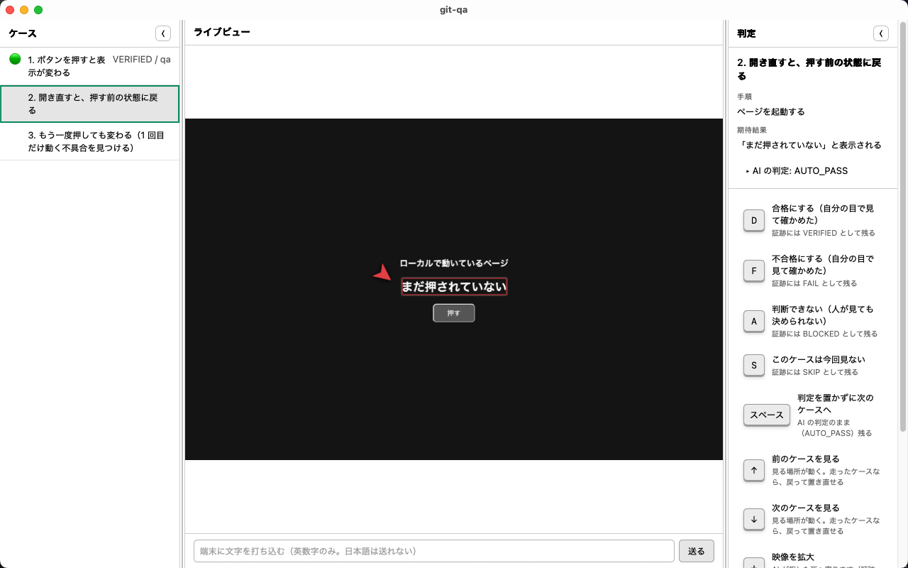
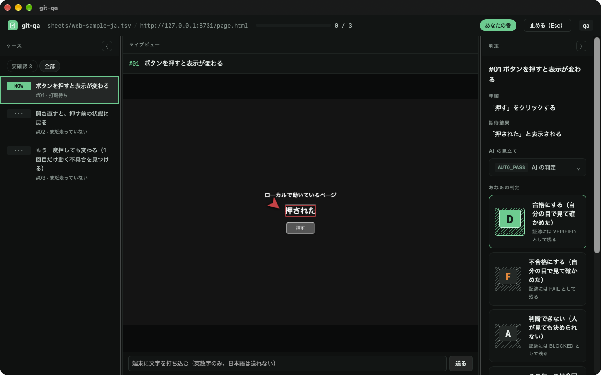
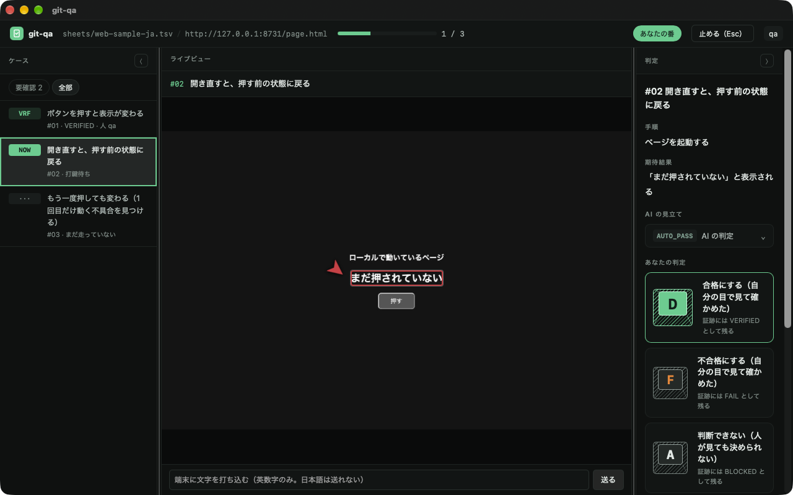
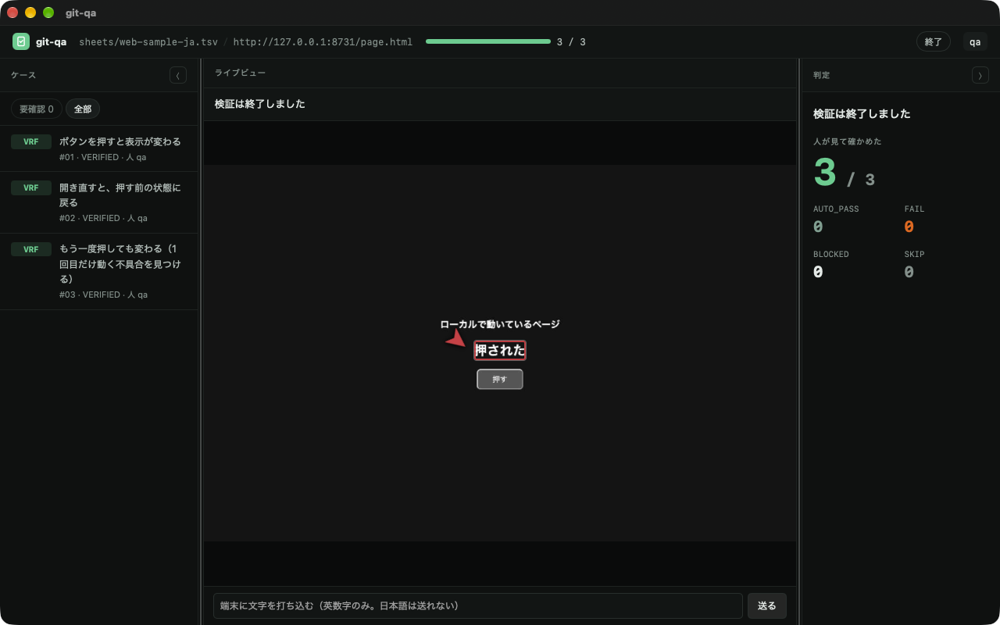
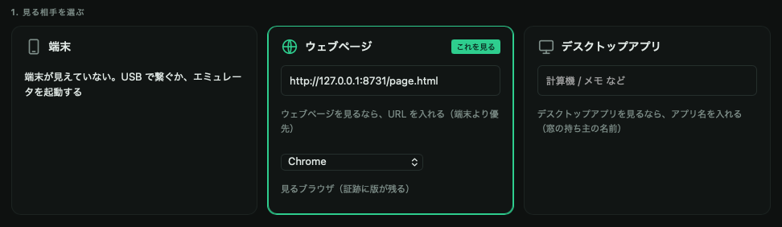
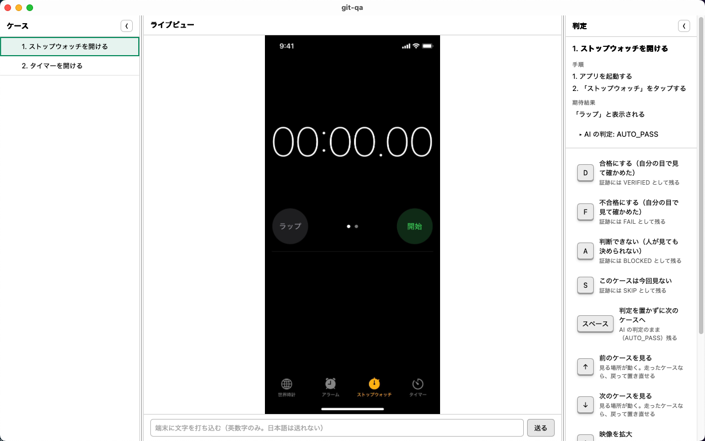

# git-qa

**Your test sheet runs itself. You watch, and sign off each case with one key.**

git-qa is an open-source **human-in-the-loop QA** runner. An AI agent works through your test sheet
on Android, iPhone, web and desktop apps; you watch the live screen and sign off each case,
and the evidence records who verified what. AI agents can also drive it over MCP.

[日本語版はこちら / Japanese](./README.ja.md) · [Download](https://meta-taro.github.io/git-qa/en/)



*Left: the cases in your test sheet. Middle: the page, device or app, live, while the AI drives it —
the red marker is where it found the expected text. Right: one key per verdict — `D` pass, `F` fail.
Your handle goes into the evidence when you press it. (The UI is shown in Japanese; it also speaks English.)*

## When you would reach for it

**The release check nobody wants to click through again.**
You have a 30-row regression sheet for an Android app, a web page and a desktop app.
Instead of tapping through it by hand, the AI follows the sheet while you watch the live view
and press a key per case. You only stop to look closely where something changed or failed.

**"Who actually checked this?"**
A client, an auditor or your own team asks after an incident. The evidence answers:
each case says `VERIFIED` (a person looked and signed) or `AUTO_PASS` (the AI passed it, nobody looked),
with the name, the time, and the screen at that moment.

**An AI agent built the feature — now it should check it, on a real device.**
Over MCP, Claude Code (or any agent) can screenshot, read the screen, list what can be pressed and tap it,
on Android, web, desktop or iPhone. It can run the sheet unattended overnight (`--no-ui`);
in the morning you review the failures. **The pass is still yours to give.**
The server is listed in the official MCP registry as `io.github.meta-taro/git-qa`; it runs from this clone (there is no npm package).

## One test, start to finish

This is the sample that ships in the repo: a three-row sheet (`sheets/web-sample-ja.tsv`) run against a
page served on your own machine (`node sheets/sample-page/serve.mjs`). Its first row:

| No. | Case | Step | Expected |
|---|---|---|---|
| 1 | Pressing the button changes the text | Click 「押す」 | 「押された」 is shown |

**1. The AI runs the step.** It opens the page in Chrome, clicks the button, reads the screen and marks
where it found the expected text. Its own result is `AUTO_PASS`: it passed the case, nobody has looked yet.
The right pane waits for you.



**2. You look, and press one key.** `D` means "I saw it, pass". The case turns `VERIFIED` with your handle
next to it, and the AI starts the next case on its own. You never touch the page.



**3. The record stays.** When the last case is placed, the run says how many a person verified, and
`runs/<run id>/run.json` keeps every case as it was judged: the AI's result, your verdict, your handle,
the time, and the screen at that moment (`case-001/screen.webp`).

```json
{
  "no": 1,
  "title": "ボタンを押すと表示が変わる",
  "aiResult": "PASS",
  "humanResult": "VERIFIED",
  "verifiedBy": "qa",
  "verifiedAt": "2026-11-25T06:24:08.169Z",
  "result": "VERIFIED",
  "screenshot": { "state": "saved", "file": "case-001/screen.webp" },
  "note": "画面の文字に「押された」が在ることだけを見た"
}
```



So the split is:

| | Who | What |
|---|---|---|
| Run | **The AI** | Opens the target, follows each step of the sheet, finds the expected text and points at it |
| Judge | **You** | Watch the live view and press one key per case. Only you can place `VERIFIED` or `FAIL` |
| Remember | **The record** | Per case: the AI's result, your verdict, your handle, the time, the screen |

The same loop runs against an Android device, a desktop app or an iPhone. Only the first choice,
what to look at, changes.

## Try it

1. Download the app from the [distribution page](https://meta-taro.github.io/git-qa/en/) (macOS, Windows x64 / ARM64) and install **Node 22+**
2. Open git-qa. Enter a handle (it goes into the evidence as "who looked"), pick what to look at —
   an `adb` device, a web page URL, or a desktop app by name — and a test sheet
3. Start, watch, and press `D` / `F` per case



A test sheet is a TSV you can write in any spreadsheet — samples are in [`sheets/`](./sheets/).
From source instead: `git clone … && pnpm install && pnpm app` (see [Install](#install)).

### Launch from another tool

Another tool (a traceability ledger, for instance) can open git-qa on a given sheet and case:

```text
git-qa://run?sheet=<absolute path to the TSV>&case=<No.>&target=<what to look at>
```

`case` runs that one case only and sets `finishedAt` in `run.json` when it is done. `target` is a URL,
`app:<name>` for a desktop app, or an adb serial. With both present and a handle already entered, the run
starts without a click; if git-qa is already open, that window takes it. Installed app only (not `pnpm app`).

## Why it is built this way

This is *not* a tool for handing verification to an AI and letting it say
"everything passed." When something ships broken, the person is accountable —
"the AI did it" is not an answer anyone accepts.

So git-qa splits the work:

- **The AI operates** the device, the browser, or the desktop app, following a test sheet
- **The human watches, and places the verdict** with a single keystroke
- **The evidence records who saw what**, and when

### The vocabulary is the point

| Value | Meaning |
|---|---|
| `VERIFIED` | **A person put their name on it** |
| `AUTO_PASS` | The AI passed it. **Nobody looked** |
| `FAIL` | It failed |
| `BLOCKED` | Could not run — a precondition was not met |
| `SKIP` | Not run |

A plain `PASS` would collapse the first two into one value. **That collapse is
exactly what this tool exists to prevent.**

You *can* place `VERIFIED` without looking. **That is a feature, not a hole.**
The moment you press the key, your handle goes into the evidence. It is a
signature, not a lock. There is no anti-cheat machinery — adding it would make a
tool that exists to save effort expensive to use.

## What it can drive

| | |
|---|---|
| **Android devices** | Real devices and emulators over `adb` — tap, swipe, type |
| **Web pages** | Chrome / Edge / Firefox / Safari. Same viewport every run, so you can compare |
| **Desktop apps** | macOS (Accessibility + Vision OCR) and Windows (UI Automation) |
| **iPhone / iPad** | Watch, read and record over USB. **Tap, type, swipe and launch apps** through WebDriverAgent, which you sign and install on the device yourself ([guide](./docs/ios-press.md)). Tried on real iPhones (iOS 17.5.1 and iOS 27), **from a Mac only — driving an iPhone from Windows has not been tried** |
| **Mobile browsers** | Android Chrome over `adb forward` + CDP — tried on a real phone (Android 15, Chrome 156): open, type, tap, screenshot and read all work; text inside input fields is not part of what it reads. iOS Safari through the iPhone path above (**not yet tried**) |
| **From an AI agent** | Over MCP — screenshot, read the screen, **list the names you can press**, tap by name. Android, web, desktop, or iPhone / iPad |



*A real iPhone, driven through WebDriverAgent: git-qa launched the Clock app and tapped "Stopwatch". The case waits for a person's verdict.*

## What evidence looks like

One folder per test run. **Commit the whole folder** if you want the test itself
under version control.

```
<workspace>/
  git-qa.json        marks this folder as one test project
  sheet.tsv          the test sheet
  runs/
    20260914-100000/
      run.json       verdicts, steps, who placed them and when
      case-001/
        screen.webp  the screen at the moment the verdict was placed
        screen.webm  video of the run — **only when asked for** (`--record`,
                     or "Record video" on the app's start screen)
```

After a verdict is placed, the app shows "Open the evidence folder" under the
path it wrote to, so the screenshot and video of each case are one click away.

Nothing about your machine goes into the evidence: paths are relative to the
workspace, so the same run reads the same way on anyone's machine.

## Requirements

- **Node 22 or newer** — required. The app starts a runner process **Node managed by fnm / nvm is only on your terminal's PATH** — an app launched from an icon or the Start menu does not see it, so install Node 22+ system-wide (the app tells you when the node it found is too old)

- `adb` for Android, a browser for web — only if you use them
- `ffmpeg` / `cwebp` — optional. Without them, evidence is kept in the format it
  was captured in, uncompressed

## Install

Download from the [distribution page](https://meta-taro.github.io/git-qa/en/), or
run it from source:

```bash
git clone https://github.com/meta-taro/git-qa.git
cd git-qa
pnpm install
pnpm app
```

macOS builds are signed and notarized. **Windows builds are not signed** — you
will see "Windows protected your PC"; check the source before choosing *Run*.

To see what this machine can actually do — measured, not guessed:

```bash
pnpm doctor
```

The app also states its own version on the start screen ("This git-qa is
v0.2.0"). **Paste that line into bug reports** — it decides which build
you are talking about. When a newer build exists, the same place says so; git-qa
never replaces itself.

## Status

**Stable since v0.2.0 (2026-11-11).** Three products use it in real verification
work on Windows and macOS, against web, desktop, Android and iPhone targets.
**iPhone targets have only been driven from a Mac; Windows to iPhone is untried** and is not promised.
Rough edges are listed in each release's notes, and **nothing fails silently** — where a step cannot run, it is recorded
as "a person needs to do this," not as a pass.

Bug reports and requests: [Issues](https://github.com/meta-taro/git-qa/issues).
**Please write them in your own words, right after you hit the problem.**
Summarizing loses the part that actually hurt.

## License

MIT — see [LICENSE](./LICENSE).
